# Architecture Snapshot: Memory Layer

> **Write Path → Retrieval Path → Forgetting Path**

The Memory Layer introduces epistemic certainty, source provenance, temporal freshness decay, and proactive forgetting into autonomous agent memory.

---

## High-Level Architecture

```
┌────────────────────────────────────────────────────────────────────────┐
│                        MEMORY LAYER ARCHITECTURE                       │
│                                                                        │
│   ┌──────────────┐    ┌─────────────────────┐    ┌─────────────────┐   │
│   │ WRITE PATH   │───▶│ CORE MEMORY STORE   │◀───│ FORGETTING PATH │   │
│   │              │    │                     │    │                 │   │
│   │ • Source     │    │ • Epistemic Scores  │    │ • Right-to-     │   │
│   │ • Base Conf  │    │ • Temporal TTL      │    │   Forget        │   │
│   │ • Contradict │    │ • Scope Partition   │    │ • Cascade Decay │   │
│   │   Detector   │    │ • Audit Log         │    │ • Tombstones    │   │
│   └──────────────┘    └──────────┬──────────┘    └─────────────────┘   │
│                                  │                                     │
│                                  ▼                                     │
│                       ┌─────────────────────┐                          │
│                       │ RETRIEVAL PATH      │                          │
│                       │                     │                          │
│                       │ • Match Ranking     │                          │
│                       │ • Freshness Decay   │                          │
│                       │ • "I Might Be       │                          │
│                       │   Wrong" Warnings   │                          │
│                       └─────────────────────┘                          │
└────────────────────────────────────────────────────────────────────────┘
```

---

## 3 Core Operational Lifecycles

```mermaid
flowchart TD
    subgraph Write["1. Write Path"]
        W1[Receive Fact] --> W2[Assign Source & Base Confidence]
        W2 --> W3[Detect Contradictions]
        W3 --> W4[Calculate Confidence Delta]
        W4 --> W5[Resolve Conflicts: Replace / Merge / Review]
        W5 --> W6[Store with Full Metadata]
    end

    subgraph Retrieval["2. Retrieval Path"]
        R1[Query Filters: Scope, Tags, Age] --> R2[Filter Memory Store]
        R2 --> R3[Calculate Match Score]
        R3 --> R4[Evaluate Freshness & Stale Decay]
        R4 --> R5[Generate 'I Might Be Wrong' Warnings]
        R5 --> R6[Rank by Confidence × Match Score]
    end

    subgraph Forgetting["3. Forgetting Path"]
        F1[User Revocation Request] --> F2[Mark Status: Revoked]
        F3[Time Decay Threshold] --> F4[Mark Status: Decayed]
        F2 & F4 --> F5[Exclude from Active Retrieval]
        F5 --> F6[Preserve Immutable Hash for Audit Trail]
    end
```



---

## Contradiction & Epistemic Uncertainty Engine

When an agent learns a new fact $F_{new}$ that contradicts an existing active fact $F_{old}$:
1. **Polarity Analysis**: Identifies opposing assertions (e.g. `likes` vs `dislikes`, `active` vs `cancelled`).
2. **Confidence Delta**: Applies confidence penalties ($\Delta_{conf} = -0.2$) to ambiguous claims.
3. **Audit Status**: Flags the memory record with `flag_for_review` status.
4. **Epistemic Warning**: When retrieving memories with confidence $< 0.5$, returns an explicit prompt banner: *"I'm not very confident about this. I might be wrong."*
