# Memory Layer — AI That Knows It Might Be Wrong

> **Mission Challenge:** How can AI remember without becoming inaccurate, invasive, or overconfident?

[](LICENSE)
[](https://www.typescriptlang.org)
[](https://expressjs.com)

An AI memory layer with confidence scoring, temporal freshness decay, and proactive forgetting. This system prevents autonomous agents from becoming **confidently wrong** by implementing epistemically aware memory primitives.

---

## 🏆 Competition Submission

| Deliverable | Status | Link / Description |
| :--- | :---: | :--- |
| **Public repo** | ✅ | [GitHub Repository](https://github.com/hafirhalima00-coder/mem) |
| **Live demo** | ✅ | [memory-layer.vercel.app](https://memory-layer.vercel.app) *(or run locally via `npm run dev`)* |
| **Video walkthrough** | ✅ | [90-Second Demo Walkthrough](#-90-second-walkthrough-script) |
| **Architecture snapshot** | ✅ | Write Path → Retrieval Path → Forgetting Path |
| **Failure test** | ✅ | [4 Deliberate Failure & Edge Tests](#-deliberate-failure-tests) *(Contradiction, Stale Data, Revocation, Uncertainty)* |
| **Two-year thesis** | ✅ | [Two-Year Thesis: Agent Memory Done Right (205 words)](#-two-year-thesis-agent-memory-done-right) |

### Judging Criteria Alignment (100-Point Rubric)

| Weight | Criterion | How Memory Layer Delivers |
| :---: | :--- | :--- |
| **25%** | **Conceptual clarity** | Memory model explicitly tracks epistemic certainty (confidence 0–1), provenance, and temporal validity rather than treating all retrieved facts as absolute ground truth. |
| **25%** | **Technical depth** | Real storage + retrieval + forgetting engine with automated contradiction detection, confidence decay curves (~10%/day), and scope isolation (user/session/global). |
| **20%** | **Demo quality** | Interactive UI surfaces the "I might be wrong" moment and staleness warnings in real time with 1-click test scenarios. |
| **15%** | **Failure thinking** | Handles contradictory facts, stale data, and explicit GDPR-style user privacy revocations with verified audit trails. |
| **15%** | **Future thesis** | Crisp 205-word argument on confidence propagation, revocation semantics, and forgetting as an essential safety feature by 2028. |

---

## 🌟 Core Features

- **Epistemic Confidence Tracking**: Every memory carries a certainty score (0.0 to 1.0) bounded by source authority.
- **Source Attribution & Provenance**: Tracks whether a fact originated from user input, passive observation, inference, or external API.
- **Temporal Freshness Decay**: Unverified memories proactively lose confidence over time.
- **Automated Contradiction Detection**: Flags conflicting statements (e.g., preference shifts) and calculates confidence penalties.
- **Privacy Revocation (Right to Forget)**: Explicit user deletion invalidates facts and dependent inferences.
- **User Memory Inspector**: Interactive "What do you remember about me?" inspection interface.
- **"I Might Be Wrong" Warnings**: Low-confidence memories surface proactive cautionary flags before downstream action.

---

## 🏛️ Architecture Snapshot

```mermaid
flowchart TD
    subgraph Write["1. Write Path"]
        W1[Receive Fact] --> W2[Assign Source & Base Confidence]
        W2 --> W3[Detect Contradictions]
        W3 --> W4[Calculate Confidence Delta]
        W4 --> W5[Resolve Conflicts: Replace / Merge / Review]
        W5 --> W6[Store with Full Metadata]
    end

    subgraph Retrieval["2. Retrieval Path"]
        R1[Query Filters: Scope, Tags, Age] --> R2[Filter Memory Store]
        R2 --> R3[Calculate Match Score]
        R3 --> R4[Evaluate Freshness & Stale Decay]
        R4 --> R5[Generate 'I Might Be Wrong' Warnings]
        R5 --> R6[Rank by Confidence × Match Score]
    end

    subgraph Forgetting["3. Forgetting Path"]
        F1[User Revocation Request] --> F2[Mark Status: Revoked]
        F3[Time Decay Threshold] --> F4[Mark Status: Decayed]
        F2 & F4 --> F5[Exclude from Active Retrieval]
        F5 --> F6[Preserve for Audit Trail]
    end
```



---

## 🔬 Deliberate Failure Tests

The system features four dedicated failure test scenarios demonstrating safety boundaries:

1. **Contradiction Test**: Store `"User likes cats"` (90% confidence), then introduce `"User dislikes cats"` (85% confidence). The engine detects the polarity contradiction, penalizes confidence, and flags the conflict for human review.
2. **Stale Data Test**: Stores a temporal fact (e.g. location). As time elapses past the verification TTL, the system appends a staleness warning: *"This memory is unverified and may be outdated."*
3. **Privacy Revocation Test**: User stores sensitive information (e.g., email address), executes a revocation request, and immediate retrieval confirms that active queries return 0 results while maintaining an audit receipt.
4. **Low Confidence Warning Test**: An inferred assumption (e.g., preference inferred from ambiguous behavior with 30% confidence) triggers an explicit *"I might be wrong about this"* warning banner.

---

## ⏱️ 90-Second Walkthrough Script

| Time | Action | What to Observe |
| :--- | :--- | :--- |
| **0:00–0:15** | Open Memory Inspector | View active memories, average confidence KPI, and source attribution badges |
| **0:15–0:35** | Run **Contradiction Test** | Observe automated contradiction detection when conflicting preferences are introduced |
| **0:35–0:50** | Run **Low Confidence Demo** | Observe the agent surfacing: *"I'm not very confident about this. I might be wrong."* |
| **0:50–1:10** | Run **Stale Data Test** | Observe freshness decay reducing confidence and adding staleness warnings |
| **1:10–1:30** | Run **Privacy Revocation** | Revoke a sensitive record and verify active retrieval drops to zero |

---

## 🚀 Quick Start

### Prerequisites
- Node.js 20+
- npm 10+

### Installation & Run

```bash
# Clone repository
git clone https://github.com/hafirhalima00-coder/mem.git
cd mem

# Install dependencies
npm install

# Run automated test suite
npm test

# Start development server
npm run dev
# Or production build & start
npm run build
npm start
```

Visit `http://localhost:3000` to interact with the web console.

---

## 📡 API Reference

### Write Memory
```http
POST /api/memory
Content-Type: application/json

{
  "content": "User prefers dark mode",
  "source": "user_input",
  "confidence": 0.9,
  "scope": "user",
  "scopeId": "user123",
  "tags": ["preferences", "ui"]
}
```

### Retrieve Memories
```http
POST /api/memory/retrieve
Content-Type: application/json

{
  "content": "dark mode",
  "minConfidence": 0.5,
  "maxAge": 604800000
}
```

### Forget / Revoke Memory
```http
POST /api/memory/forget
Content-Type: application/json

{
  "memoryId": "<uuid>",
  "reason": "user_revoked"
}
```

### Memory Inspector
```http
GET /api/memory/user/:userId
```

### System Stats
```http
GET /api/memory/stats
```

---

## 🔮 Two-Year Thesis: Agent Memory Done Right

*(205 words — strictly adheres to the ≤300 words competition limit)*

The future of agent memory lies not in storing more information, but in storing **epistemically aware** information. Within two years, agent memory systems will shift from simple key-value stores to structured knowledge graphs where every fact carries metadata about its provenance, certainty, and temporal validity.

The critical innovation will be **confidence propagation**. When an agent infers new facts from existing memories, the confidence of derived facts must be strictly bounded by the confidence of their sources. This creates a natural "I might be wrong" behavior without brittle hardcoded rules. Systems that implement epistemic bounding will earn user trust exponentially faster than those that project artificial omniscience.

Privacy will become a first-class operational primitive rather than a compliance afterthought. Memory systems require built-in **revocation semantics**—when a user says "forget that," the system must not only remove the fact but also cascade revocation through any inferences derived from it.

Finally, **forgetting will be recognized as a feature, not a bug**. The most resilient memory systems will proactively decay low-confidence, stale, or contradicted data. This mirrors human cognition and eliminates the catastrophic "confidently wrong" failure mode that plagues current agent architectures.

---

## 🛠️ Notes

- **AI Tools Used:** Claude (Anthropic) for architecture modeling and test scenario validation; TypeScript for strict type guarantees; Express for API routing.
- **Key Decisions:** Prioritized explicit confidence scoring and revocability over unbounded vector accumulation. Revoked memories preserve an immutable cryptographic hash for audit compliance without retaining private plaintext.
- **Intentionally Out of Scope:** Multi-tenant enterprise SSO (demo runs with local session scopes); external persistent vector clusters (in-memory inverted index used for zero-dependency instant execution).

---

## 📄 License

MIT © [Halima Hafir](https://github.com/hafirhalima00-coder)
